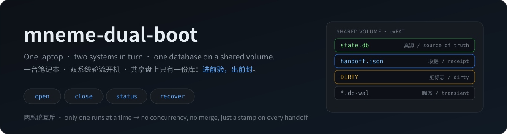
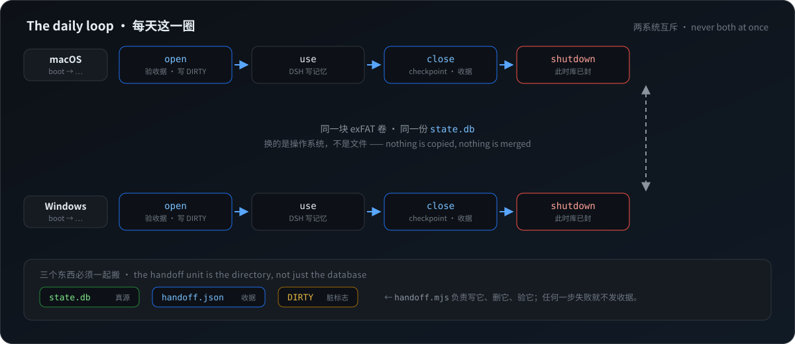

# mneme-dual-boot

<p align="center">
  
</p>

<p align="center">
  <a href="README.md"></a>
  <a href="README.zh-CN.md"></a>
</p>

<sub>中文版 (Chinese): [README.zh-CN.md](README.zh-CN.md) — use the button above, or this link.</sub>

<p align="center">
  
  
  
  
  
</p>

**One laptop. Two operating systems (hackintosh macOS + Windows). One memory database. One at a time.**

This is how I run [`@modusensus/dsh-mneme`](https://github.com/slow-stack/mneme)'s `memoryDir` on a volume that both systems mount — written up so the next person doesn't have to rediscover it the hard way. The protocol underneath is generic (any single SQLite state file, any dual-boot machine); the case that produced it is mine.

> ⚠️ **This is not a sync tool.**
> A dual-boot machine never runs both systems at once, so there is **nothing to synchronise** — whoever booted owns the file.
> The real enemy is not "the two sides disagree", it is **"the next side trusts whatever the previous side left behind"**.
> An SQLite database on a journal-less volume looks perfectly fine after a crash, a hard shutdown, or an unclean unmount — right up until you write enough data to discover it was already broken. That is the single problem this repo is about.

📄 **Fully bilingual.** Every document exists twice — `docs/NN-*.md` (中文) and `docs/NN-*.en.md` (English) — and every file carries the same switcher at the top. This README: [中文版](README.zh-CN.md).

---

## 💥 Why this needed writing down

Putting a database on a shared volume is, on the surface, two lines:

```bash
ln -s /Volumes/Shared/state.db ~/.app/state.db     # macOS
mklink  C:\Users\me\.app\state.db X:\state.db      # Windows
```

**Those two lines destroy people's databases.** They aren't wrong, they just don't mention the price:

- exFAT has no journal — a crash inside a write transaction can damage not just the file but the volume;
- exFAT has no POSIX permissions — your database is readable by every account on the machine;
- exFAT timestamps run from **10 ms (macOS) to 2 seconds (Windows driver)** — a **200×** spread on one and the same volume — and the two systems' clocks drift besides, so you cannot use mtime to decide which side is newer;
- both systems see **the same bytes** but bring **their own cache, their own mount state, their own crash-recovery logic**.

Everything below is the verifiable envelope around those two lines.

---

## 📊 Measured (Windows and macOS columns)

Reproduce with [`lab/`](lab/README.en.md). All of it on a real dual-boot shared exFAT volume, not a simulation.

- **Windows column**: Node 24 + SQLite 3.53.4, raw output in [`lab/exfat-probe-result.json`](lab/exfat-probe-result.json)
- **macOS column**: darwin / Node v24.22.1 + SQLite 3.53.4, raw output in [`lab/exfat-probe-result-macos.json`](lab/exfat-probe-result-macos.json). ⚠️ Three raw probe values there are **wrong** (mtime, permissions, the chmod no-op); the re-measured values and the reasoning are in that file's `corrections` block — read it before quoting the numbers.

| Property | Windows side | macOS side | Consequence |
|---|---|---|---|
| Volume | exFAT, hundreds of GB (plenty free) | exFAT, same class of volume, mounted `noowners, noatime, fskit` | no journal, no permissions, no hard links |
| Allocation unit | **128 KiB** (a 1-byte file occupies 131,072 bytes) | **128 KiB** (same 131,072 bytes) | a snapshot chain of small files wastes a lot of space |
| mtime granularity | **2.000 s** (20 writes in 5 s produced 4 distinct timestamps) | **10 ms** (200 consecutive rewrites produced 78 distinct timestamps, positive steps always exactly 10.000 ms; APFS on the same machine: 200/200 distinct, sub-millisecond) | ⚠️ **never judge recency by timestamp** — one exFAT spec, two drivers, 200× apart |
| Case sensitivity | insensitive: `CaseProbe.TXT` and `caseprobe.txt` are the same file; writing the lower name overwrites the upper | insensitive (writing the lower name overwrote the content) | path checks and case-varied copies actively collide |
| POSIX permissions | `chmod 0600` yields mode `666` | mode is **frozen at `0o700`**: `chmod 600` / `777` / `000` change nothing and raise no error, and the file is still readable after `chmod 000` — **chmod is a complete no-op**, because the mount carries `noowners` | ⚠️ the database is world-readable on that machine; ⚠️ do not read `0700` as "permissions are enforced" |
| Symlinks / hard links | both fail (`EISDIR`, errno −4068) | **symlinks work**: absolute and relative both create, `readlink` round-trips, the link follows and reads; **hard links fail** (`ENOTSUP`, errno −45) | a link-based layout is available on macOS; ⚠️ Windows still cannot create them, and **whether Windows can read a symlink macOS created on exFAT is UNVERIFIED** |
| `rename` over an existing file | **works** | **works** (`ok:A`) | ✔ atomic replacement available (the protocol needs it) |
| Exclusive create `open(...,'wx')` | **works**; second writer gets `EEXIST` | **works** (`blocked:EEXIST`) | ✔ lock primitive available |
| SQLite cross-process locks | **work**: second process refused in both `delete` and `wal` modes | **work** (same `lab/` cases pass) | ✔ single-writer enforcement available |
| WAL | works; `wal_checkpoint(TRUNCATE)` takes `-wal` to 0; a clean close removes `-wal`/`-shm` | works; `wal_checkpoint(TRUNCATE)` returned `{busy:0, log:0, checkpointed:0}`, `-wal` went to 0; after a clean close no wal/shm/journal remained | handoff must checkpoint explicitly |
| Commit cost | `journal_mode=delete`: **4.9–5.2 ms**; `wal`: **1.4–1.6 ms** (300 synchronous commits) | `delete`: **14.23 ms**; `wal`: **1.89 ms** (300 synchronous commits) | WAL wins on both; `delete` is ~7.5× more expensive on macOS |
| Cost of a 152 MB handoff | read + write-with-fsync + sha256 ≈ **0.9–1.2 s** | read 283 ms + write with fsync 455 ms + sha256 1327 ms = **2066 ms (≈2.1 s)**, write verified | roughly one to two seconds per boot/shutdown |
| ⚠️ Does the `-wal` file reach the disk? | original claim: a child committed 500 times in WAL mode and no `-wal` existed on disk (3 reproductions) | **explained: not the volume and not a driver flag — V8 GC collects the `DatabaseSync` handle and the connection is closed** (see conclusion 5; reproduce with `node lab/b5-gc.mjs <dir>`) | never use WAL presence/size as evidence |
| A real database, checked | a few hundred MB, page 4096, freelist 4.5%, 22 tables, `integrity_check` = ok in 1141 ms | **a few hundred MB (plus a sub-MB WAL), page 4096, freelist 1.3%, 22 tables, `integrity_check` = ok** | for this size, a physical runs in about a second |

### 🧠 Five conclusions

1. **The locks are fine; the timestamps are not — and how badly depends on the driver.** SQLite's cross-process locking works on exFAT, and so do `rename` and `open(wx)`: every primitive the protocol needs is there. What breaks is the naive "how long has this file been idle" test, and it breaks inconsistently — one exFAT spec, 2 seconds under the Windows driver, 10 ms under macOS, a **200×** spread. "Unchanged here" may mean "just written there". **Hash the content; never trust mtime.**
2. **Permissions are gone, and on macOS they put on a convincing costume.** On Windows `chmod` leaves mode `666`; on macOS, because the mount carries `noowners`, every file reads `0o700` and `chmod 777`/`000` neither works nor complains — the file is still readable after `chmod 000`. The real trap is that this turns checks into false positives: the probe's own `permissions_enforced` reported `true` on macOS, because it only tests `mode & 0o077 === 0` and macOS reports 0700 unconditionally. A database on this volume is readable by any account that can log in. Accept it, or make the volume encrypted — but don't pretend `chmod` protects you.
3. **Case-insensitivity means "two files" can be one file.** Any design that keeps copies distinguished by case, or validates by path spelling, is wrong on this filesystem.
4. **WAL makes you faster and hands you one more state to handle at handoff.** On a clean close SQLite checkpoints and removes `-wal`/`-shm` by itself; after a crash or a hard shutdown it does not. **The first step of any handoff is an explicit `PRAGMA wal_checkpoint(TRUNCATE)` — never hope the app did it on exit.**
5. **The anomaly I could not explain is explained: it is V8's garbage collector, not the volume.** The original record was: a child process committed **500 times** in WAL mode, never closed, then got `SIGKILL`ed, and throughout there was **no `-wal` file on disk** while all the data sat inside the 16 KB main file. The observation is real, but it was **attributed to the wrong layer** — it has nothing to do with the filesystem.

   `node:sqlite` closes its connection when the `DatabaseSync` object is **garbage-collected**. The original `crash-probe` child wrote its signal file and then span in a busy loop, **never referencing `h` again**; the handle became unreachable, got collected, and the connection was closed — and for SQLite, the last connection closing means **a clean close**: checkpoint the WAL into the main file, then delete `-wal`/`-shm`. The parent sampled exactly that post-close state, which made it look like the volume was swallowing WAL frames.

   [`lab/b5-gc.mjs`](lab/b5-gc.mjs) turns it into a one-command A/B/C:

   | Variant | exFAT | APFS |
   |---|---|---|
   | A: `h` never referenced again (`crash-probe` verbatim) | `-wal` gone **3/3** | gone **2/2** |
   | B: one extra line, `globalThis.__keep = h` | gone **0/3** | gone **0/2** |
   | C: explicit `h.close()` | gone 3/3, identical end state to A | same |

   The only variable is **whether the JS handle is still referenced**. Filesystem, `journal_mode`, `synchronous` and explicit transactions were each ruled out separately (in every one of those combinations `-wal` stayed at 2,080,632 B and the main file at 4,096 B). APFS behaves identically, so the "volume write cache" explanation is dead; "a `node:sqlite` connection flag" is dead too — it was never a flag.

   Two consequences, both now in the protocol:
   - **No data was lost.** GC triggers a *clean* close: the WAL is checkpointed before deletion, and all 500 rows are in the main file. The danger is the **inference**, not the data.
   - **A live process does not mean a live database.** A process can close its database without exiting — `ps` still shows state `R`, yet `lsof` shows not one `state.db` descriptor and the directory has no `-wal`/`-shm`. So test liveness with `lsof +D <dir>` (verified working on macOS/exFAT; it names the holder of `state.db` and `state.db-wal`), **not with `kill -0` and not by trusting the process name**.

   The conclusion is therefore harder than before: **never treat "is there a `-wal`", "`-wal` size" or "main file size" as evidence of anything**, and never infer "the database is still open" from "the process is still running". Trust only hashes you computed, integrity checks you ran, and receipts you wrote.

---

## 🧭 The protocol in one sentence

> **Verify before you enter; seal before you leave; anything unsealed is not to be trusted.**

The full spec (file formats, state machine, atomicity requirements, rotation and rollback) is [`docs/02-handoff-protocol.en.md`](docs/02-handoff-protocol.en.md). It comes down to three artifacts:

- `state.db` — the single source of truth, on the shared volume;
- `handoff.json` — the **receipt**: generation, owner, close time, size, sha256, integrity result;
- `DIRTY` — a marker **written on open, deleted on clean close**. If the next boot sees it, the previous session did not finish properly: go to recovery, do not open the database.

The generation (`gen`) is **an integer you increment yourself**, not a timestamp — because timestamps are not trustworthy on this filesystem.

<p align="center">
  
</p>

---

## 🧰 Reference implementation: `handoff.mjs`

Zero dependencies, one file, Node ≥ 22 (uses `node:sqlite`, `node:crypto`, `node:fs`). Copy it anywhere and run it; there is nothing to install.

```bash
node handoff.mjs open    <shared-dir> --owner windows   # after boot, before starting the app
node handoff.mjs close   <shared-dir> --owner windows   # after the app exits, before shutdown
node handoff.mjs status  <shared-dir>                   # read-only: can this database be trusted now
node handoff.mjs recover <shared-dir>                   # last session did not finish: check, then roll back if needed
```

Metadata lives in `<shared-dir>/.handoff/`, next to your data — so it travels with the volume, and you can never end up with the receipt on one disk and the database on another.

| Exit code | Meaning | What to do |
|---|---|---|
| 0 | ok | carry on |
| 10 | `DIRTY` present — last session did not close cleanly | run `recover` |
| 11 | database sha256 does not match the receipt | run `recover` (a crash, a manual edit, or a second writer) |
| 12 | `integrity_check` failed | run `recover`; the bad file was renamed into `abandoned/`, **not deleted** |
| 13 | no receipt (first run) | `close` once to establish a baseline; see `docs/02` §7 |
| 14 | receipt came from a newer protocol version | don't let an older hand write over a newer one |
| 20 | cannot take the write lock — something still holds the database | stop the app (including tray/menubar processes) and retry |
| 21 | `wal_checkpoint` left data in the `-wal` | don't shut down; find out who is still writing |
| 22 | no usable snapshot | see `docs/03` §5 |
| 30 | bad usage | see `--help` |

**`close` does not "try its best".** If any step fails it does not write a receipt and does not delete `DIRTY`; it would rather make you run it again. That is deliberate: a database that *looks* clean is far more dangerous than one that clearly reports a problem.

The implementation has been driven through 13 end-to-end scenarios on a real exFAT volume (normal handoff, double open, dirty marker, healthy recovery, bad-page detection, rollback, snapshot rotation, hand-edited mirror, hand-edited database, another process holding the lock) — all as expected. A damaged database is always **renamed and kept**, never deleted; snapshots are **read back and re-hashed after writing**, not trusted on write.

Want to see it yourself? Clone onto the shared volume and run one command:

```bash
node lab/handoff-selftest.mjs E:/_hstest     # 18 assertions, a few seconds
```

It creates a database **on your volume**, then pushes it through nine situations (including page-level corruption and rollback), asserting exit codes. Expected values are tabulated in [`lab/README.en.md`](lab/README.en.md).

---

## ✨ Where this came from: mneme

None of this was designed in the abstract. It solves one specific problem: **my AI memory database ([`@modusensus/dsh-mneme`](https://github.com/slow-stack/mneme), MIT) has to be the same `memory.db` in both systems of one dual-boot laptop.**

So the most convincing evidence is that it is actually running:

```yaml
# both sides point at the same physical directory
memoryDir: E:/mneme                      # Windows
memoryDir: /Volumes/Shared/mneme          # macOS — the same directory
```

```bash
node handoff.mjs open  E:/mneme --owner windows   # after boot
#   ... use DSH, write memories freely ...
node handoff.mjs close E:/mneme --owner windows   # after DSH exits AND the daemon is stopped
```

mneme guarantees a single writer **within one process** (memory consolidation is only wired into the host process). It cannot see that the previous boot belonged to a different operating system — exactly the hole this protocol fills. The concrete setup, why the daemon (`dsh-mneme-serve`, default `127.0.0.1:8790`) must be stopped before `close`, and why the handoff unit is **the whole directory** rather than just `memory.db`, are in [`docs/05-mneme-setup.en.md`](docs/05-mneme-setup.en.md).

> Not using mneme? Then you only need `docs/01`–`04`. The protocol does not know about mneme, and neither does `handoff.mjs`.

---

## ✅ Scope

**✅ Fits**

- one machine, two systems taking turns (mutually exclusive)
- the state lives in **a single file** (SQLite, KeePass, some note apps, a git repo)
- the shared volume is exFAT / FAT32 / NTFS (read-only on macOS) — anything without POSIX semantics
- you are willing to pay 1–2 seconds per boot and per shutdown

**❌ Does not fit**

- ❌ **two machines that can be on at the same time** — that is real concurrent writing and needs real conflict resolution
- ❌ several applications writing the same database
- ❌ a filesystem without atomic `rename` (then there is no safe way to land a receipt)
- ❌ "I want it invisible and free" — every step here is deliberate friction, and the friction is the insurance

---

## 🙈 What is not here

The honest limits are listed in [`docs/01-failure-modes.en.md`](docs/01-failure-modes.en.md) (see the unverified list at the end). Short version:

- **macOS is measured now — but not completely.** The numbers column is real on both sides, and three Windows-era claims turned out to be Windows-specific. Still unmeasured on macOS: the exFAT driver's unmount behaviour after a hard shutdown, what `fsck_exfat` actually repairs, whether Spotlight / `.fseventsd` touch the database while the app is writing, and behaviour after a real power loss. Measured and now dependable: mtime granularity, `chmod`, symlinks, `lsof`-based liveness.
- **No destructive experiments** (power loss, yanking the disk) — they would destroy the only database I have. Every "crash" result here comes from `SIGKILL`, not from cutting power; the difference is **the filesystem's own consistency**, which is precisely what exFAT does not have. This is the biggest known blind spot: read everything as "the worst case is worse than what is written here".
- **No boot automation.** No systemd / launchd / scheduled task, and nothing guarantees `open` runs before the app starts. Two systems need two setups, and getting it wrong is worse than not having it, so it is left to you.
- **No volume identity check.** The protocol (I7) says identify the volume by serial number, not drive letter; the implementation does not do it yet — copy the whole directory to another disk and it will not notice.
- **No GUI, no daemon, no installer.** It is four commands. That's it.

---

## 🗂️ Layout

| File | Contents |
|---|---|
| [`handoff.mjs`](handoff.mjs) | **Reference implementation**: `open` / `close` / `status` / `recover`, zero dependencies |
| [`docs/01-failure-modes`](docs/01-failure-modes.en.md) | Failure-mode inventory: filesystem / SQLite / timing / human |
| [`docs/02-handoff-protocol`](docs/02-handoff-protocol.en.md) | **Handoff protocol spec v0**: receipt, dirty marker, state machine, rollback |
| [`docs/03-recovery-runbook`](docs/03-recovery-runbook.en.md) | What to do on the bad day (including "when not to rescue") |
| [`docs/04-why-not-sync`](docs/04-why-not-sync.en.md) | Why there is **no** sync: the designs that were rejected, and why |
| [`docs/05-mneme-setup`](docs/05-mneme-setup.en.md) | The concrete mneme setup (daemon, whole-directory handoff) |
| [`lab/`](lab/README.en.md) | Reproducible probes: every row of the table above comes out of these |

---

## 📜 License

MIT. These numbers and this protocol were paid for in mistakes; hopefully someone else skips one.

If you measure something different (especially on the macOS side), please open an issue — that is the part of this document that is most missing.
